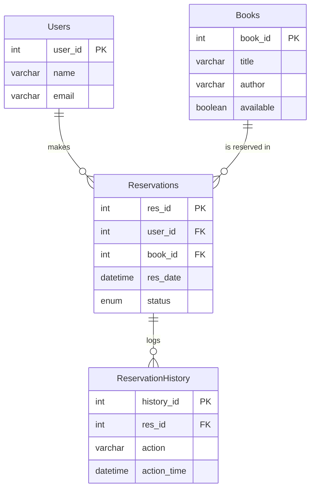

# Library Book Reservation System

A DBMS mini project: members reserve, cancel and return library books through a simple web page. The database does the real work with a **stored procedure**, **CASE (switch-case) logic** and **triggers**.

No PHP. Built with Node.js, Express, MySQL and plain HTML/CSS/JavaScript. Works in VS Code.

## Features

- Reserve, cancel and return books (one form, one stored procedure)
- Add members and books from the web page (data goes into the tables)
- Triggers enforce a 3-active-reservations limit and log every change automatically
- Live tables for books, reservations, members and the activity log

## Tech stack

| Part | Technology |
|------|-----------|
| Front-end | HTML, CSS, JavaScript |
| Back-end | Node.js + Express |
| Database | MySQL 8 (stored procedure, triggers) |
| Editor | Visual Studio Code |

## Project structure

```
library-reservation-system/
├── server.js              # Express app and error handler
├── db/connection.js       # MySQL connection pool
├── routes/
│   ├── users.js           # GET/POST members
│   ├── books.js           # GET/POST books
│   └── reservations.js    # reserve / cancel / return, list, history
├── public/
│   ├── index.html         # page
│   ├── style.css
│   └── app.js             # front-end logic
├── sql/
│   ├── schema.sql         # tables + triggers + stored procedure
│   ├── sample_data.sql    # example members and books
│   └── test_queries.sql   # queries to demo the procedure and triggers
├── .env.example
└── package.json
```

## Database design



### Stored procedure: `ManageReservation(action, user_id, book_id)`

Uses a `CASE` statement, which is SQL's switch-case:

| Action | What it does |
|--------|--------------|
| `RESERVE` | Checks the book is available, inserts a reservation, marks the book unavailable |
| `CANCEL` | Marks the member's active reservation `CANCELLED`, frees the book |
| `RETURN` | Marks the active reservation `RETURNED`, frees the book |
| anything else | Raises an "Invalid action" error (`ELSE` branch) |

It also validates the member and book, runs inside a transaction, and rolls back on any error.

### Triggers

| Trigger | Fires | Purpose |
|---------|-------|---------|
| `BeforeReservationInsert` | before a reservation is inserted | Blocks a member from holding more than 3 active reservations |
| `AfterReservationInsert` | after a reservation is inserted | Writes `RESERVED` to `ReservationHistory` |
| `AfterReservationUpdate` | after a reservation's status changes | Writes `CANCELLED` or `RETURNED` to `ReservationHistory` |

### Where switch-case is used

1. `CASE` in the stored procedure (`sql/schema.sql`)
2. `switch` in `routes/reservations.js` (validates the action)
3. `switch` in `public/app.js` (picks the status badge)

## Setup

**Requirements:** [Node.js](https://nodejs.org) 18+ and MySQL 8 (or MariaDB 10.5+).

```bash
# 1. Get the code
git clone <your-repo-url>
cd library-reservation-system

# 2. Create the database, triggers and procedure
mysql -u root -p < sql/schema.sql
mysql -u root -p < sql/sample_data.sql

# 3. Configure the connection
cp .env.example .env        # on Windows: copy .env.example .env
# then edit .env and set DB_PASSWORD

# 4. Install and run
npm install
npm start
```

Open <http://localhost:3000>.

> You can also run the `.sql` files from MySQL Workbench. Run `schema.sql` first, then `sample_data.sql`.

## Try it

1. Choose **Reserve a book**, pick Alice and "The Great Gatsby", click **Submit**.
2. Try to reserve the same book as Bob: you get "Book is not available".
3. Open the **Activity log** tab: the row was added by a trigger.
4. Reserve three books as one member, then a fourth: the trigger blocks it.
5. Use **Return a book** or **Cancel a reservation** and watch the book become available again.

## API

| Method | Route | Body |
|--------|-------|------|
| GET | `/api/users` | |
| POST | `/api/users` | `{ "name", "email" }` |
| GET | `/api/books` | |
| POST | `/api/books` | `{ "title", "author" }` |
| GET | `/api/reservations` | |
| GET | `/api/reservations/history` | |
| POST | `/api/reservations` | `{ "action": "RESERVE" \| "CANCEL" \| "RETURN", "user_id", "book_id" }` |

## Troubleshooting

- **`ECONNREFUSED`**: MySQL isn't running, or `.env` has the wrong host.
- **`Access denied`**: wrong `DB_USER` / `DB_PASSWORD` in `.env`.
- **`PROCEDURE ... does not exist`**: run `sql/schema.sql` again.
- **MySQL 8 `ER_NOT_SUPPORTED_AUTH_MODE`**: use a user created with `mysql_native_password`, or upgrade `mysql2`.

## License

MIT
